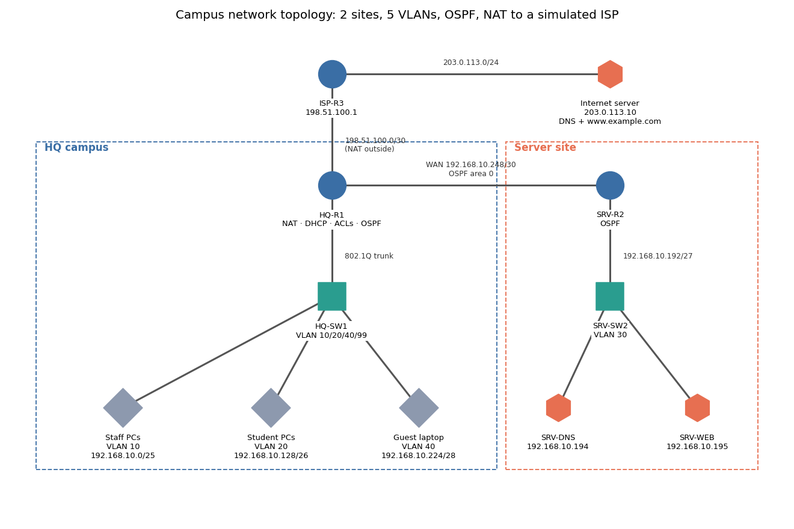

# Campus Network Build: Cisco Packet Tracer

**Quick summary:** A two-site network for a small school, designed and configured in Cisco Packet Tracer. It uses VLANs, inter-VLAN routing, DHCP, OSPF, NAT/PAT to a simulated ISP, and security hardening (ACLs, SSH-only management, port security).

## Description
The school has staff, students, guests, and a separate server room. Each group gets its own VLAN and subnet, so a problem or attacker in one group can't freely reach the others. The HQ router hands out IP addresses (DHCP), routes between VLANs, shares one public IP with everyone (NAT), and learns the server-site routes automatically (OSPF).

The addressing plan was produced with my own **[subnet calculator](https://github.com/victorfang-edit/subnet-calculator)** using VLSM: 6 subnets fit into a single /24 with 98% of addresses allocated.

### Addressing table
| Network | VLAN | Subnet | Gateway | Hosts |
|---|---|---|---|---|
| Staff | 10 | 192.168.10.0/25 | .1 | 126 |
| Students | 20 | 192.168.10.128/26 | .129 | 62 |
| Servers | 30 | 192.168.10.192/27 | .193 | 30 |
| Guest | 40 | 192.168.10.224/28 | .225 | 14 |
| Management | 99 | 192.168.10.240/29 | .241 | 6 |
| WAN HQ↔Servers | – | 192.168.10.248/30 | .249 / .250 | 2 |
| ISP link | – | 198.51.100.0/30 | ISP .1 / HQ .2 | 2 |
| "Internet" | – | 203.0.113.0/24 | .1 | server .10 |

| Device | Interface | IP |
|---|---|---|
| HQ-SW1 | VLAN 99 | 192.168.10.242 |
| SRV-SW2 | VLAN 30 | 192.168.10.222 |
| SRV-DNS | Fa0 | 192.168.10.194 |
| SRV-WEB | Fa0 | 192.168.10.195 |
| PCs / laptops | – | DHCP |

Public addresses come from the RFC 5737 documentation ranges, so no real internet IPs are used.

## Tools Used
- **Cisco Packet Tracer 8.x**: 3× 2911 routers, 2× 2960 switches, PCs, servers
- **Cisco IOS CLI**: all configs are in [`docs/configs/`](docs/configs)
- **Python + NetworkX/Matplotlib**: topology diagram (`topology.py`)
- My **subnet-calculator**: VLSM plan

## Scope
| In scope | Out of scope |
|---|---|
| VLANs, 802.1Q trunk, router-on-a-stick | Redundant links / HSRP |
| DHCP pools with exclusions | Wireless controllers |
| OSPF (single area) + default route injection | IPv6 |
| NAT overload (PAT) | Real hardware |
| ACLs, SSH v2, port security, BPDU guard, unused ports shut | |

## Security design (why each control exists)
| Control | Protects against |
|---|---|
| Separate VLANs per group | A compromised student or guest device reaching staff machines |
| `STUDENTS-IN` ACL | Students reaching Staff and Management subnets |
| `GUEST-IN` ACL | Guests reaching *any* internal network (internet only) |
| SSH v2 only + `VTY-ADMIN` ACL | Telnet sniffing, and management logins from untrusted subnets |
| Port security (sticky MAC, max 2) | Someone plugging in a rogue switch or unknown device |
| BPDU guard + PortFast | Spanning-tree attacks and loops from access ports |
| Unused ports shut down in a parked VLAN | Walk-up network access |
| Native VLAN moved to 999, `nonegotiate` | VLAN-hopping (double-tagging / DTP attacks) |
| `enable secret`, `service password-encryption` | Plain-text passwords in the config |

> Passwords in the configs are `LabOnly-ChangeMe` placeholders. Real credentials should never go in a public repo.

## Objective
Show that I can plan, build, secure, and verify a multi-VLAN routed network end to end, the same work as a junior network or IT support technician on a real site.

## Result: verification test plan
| # | Test | Command / action | Expected |
|---|---|---|---|
| 1 | DHCP works | Staff PC → `ipconfig` | 192.168.10.11+ /25, GW .1, DNS .194 |
| 2 | Inter-VLAN routing | Staff PC → `ping 192.168.10.195` | Success |
| 3 | OSPF adjacency | HQ-R1 `show ip ospf neighbor` | 2.2.2.2 FULL |
| 4 | Default route learned | SRV-R2 `show ip route` | `O*E2 0.0.0.0/0` via .249 |
| 5 | Internal DNS + web | Staff PC browser → `intranet.campus.lab` | Page loads |
| 6 | NAT | Staff PC → `ping 203.0.113.10`, then HQ-R1 `show ip nat translations` | Success, translations to 198.51.100.2 |
| 7 | Student isolation | Student PC → `ping 192.168.10.11` (staff) | Fails (ACL), and `show access-lists` hit count increases |
| 8 | Guest isolation | Guest → `ping 192.168.10.194` | Fails. Guest → `www.example.com` loads |
| 9 | Management lockdown | Staff PC `ssh -l admin 192.168.10.242` works; from a Student PC it's refused | As described |
| 10 | Port security | Plug a second switch/extra PCs into Fa0/1 | Violations counted, port restricts |

### Screenshots
<!-- Take these in Packet Tracer and save them in docs/screenshots/ with these names -->
| Topology in Packet Tracer | OSPF neighbors | NAT translations |
|---|---|---|
|  |  |  |

| ACL blocking student → staff | Guest reaching the internet | DHCP lease on a PC |
|---|---|---|
|  |  |  |

## What I Learned
- **Router-on-a-stick:** one physical link carries every VLAN, using 802.1Q tags and one subinterface per VLAN.
- **ACL placement:** extended ACLs go close to the *source*, and order matters (first match wins, with an invisible `deny any` at the end). I had to add a `permit` for DHCP and for pinging the gateway *before* the guest deny rule.
- **NAT is why the internet "works" with private IPs:** the ISP has no route to 192.168.10.0/24, so replies only come back because HQ-R1 rewrites the source address.
- **OSPF `default-information originate`** spreads the default route automatically instead of configuring it on every router.
- **Wildcard masks** are the inverse of subnet masks (/27 → 0.0.0.31).
- Defense in depth on a LAN: most attacks start at an access port, so switch hardening matters as much as the firewall.

## Rebuild It
1. Place devices and cable them as in the diagram (Gig0/1 on each switch is the uplink).
2. Paste each file from `docs/configs/` into the matching device's CLI.
3. Servers: set static IPs. On SRV-DNS add records `intranet.campus.lab → 192.168.10.195` and `www.example.com → 203.0.113.10`. On the Internet server, enable HTTP and DNS with `www.example.com → 203.0.113.10`.
4. Set every PC to DHCP and run the test plan above.
5. Save the lab as `campus-network.pkt` in this repo.
